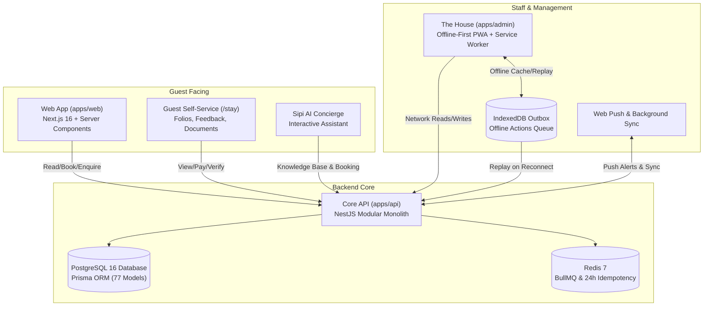

# Reberon Hotel Suite — Master Feature Specification & Technical Reference

*Comprehensive system documentation as of November 2026 (incorporating ADR-001 through ADR-033).*

The **Reberon Hotel Suite** is a unified, offline-first hospitality management and guest experience platform engineered specifically for **Reberon Hotel**, situated at 1,900 m on the slopes of Mount Elgon in Kapchorwa, Uganda.

The suite comprises three tightly integrated applications built on top of shared core packages:
1. **The Guest Website (`apps/web`)** — High-performance, SEO-optimized public portal, online booking engine, Sipi AI Concierge, and guest self-service hub.
2. **The House Management Platform (`apps/admin`)** — Installable, offline-first Progressive Web Application (PWA) powering front desk operations, housekeeping, kitchen/bar POS, health club/spa, inventory, HR, accounting, and content management.
3. **The Core API (`apps/api`)** — NestJS backend providing authoritative validation, database transaction boundaries, Redis-backed idempotency, immutable document generation, and external service orchestration.

---

## Architecture & Foundational Principles

### 1. Dual-Currency Financial Integrity (ADR-007)
- **Zero Silent Conversions**: Monetary values are permanently stored as integers in minor units alongside their ISO currency code (`UGX` and `USD`). UGX and USD are never summed or converted silently.
- **Folio Immutability**: All guest billing ledgers, restaurant bills, and invoices are strictly append-only. Mistakes are corrected by posting offset lines (`ADJUSTMENT`, `DISCOUNT`, `WRITE_OFF`), never by modifying or deleting historical rows.
- **Gap-Free Numbering**: Official documents (`RCT` receipts, `INV` invoices, `RFD` refund notes) are sequenced in atomic PostgreSQL transactions without gaps.

### 2. Double-Booking & Overselling Prevention (ADR-018)
- Room occupancy is enforced via PostgreSQL exclusion constraints on `RoomAssignment` ranges.
- Room blocks (e.g. for maintenance or deep cleans) raise `InventoryDay.blockedRooms` atomically. An allocation request that exceeds inventory availability is refused at the database level.

### 3. Offline-First PWA Architecture (ADR-029 & ADR-030)
- **Preload-On-Boot**: The service worker (`sw.js`) automatically pre-caches all 45 permitted `/app/(house)` routes and script dependencies on initial sign-in and upon new version deployments.
- **Three-Tier Caching**:
  - Static bundles: Cache-First.
  - Page routes: Network-First with a 3.5s timeout fallback to cached copies.
  - API reads: Cached per signed-in user with background revalidation every 15 minutes.
- **IndexedDB Outbox & Redis Idempotency**: Offline mutations are stamped with unique `Idempotency-Key` headers and queued in IndexedDB. Upon reconnection or via Background Sync, mutations replay against the API's global `IdempotencyInterceptor` (backed by Redis with a 24-hour TTL) guaranteeing exactly-once execution.
- **Provisional POS Receipts**: Till staff can continue ringing up food, drinks, and day passes when offline; provisional slips print immediately, and fiscal numbered receipts are issued automatically upon synchronization.

---

## Module 1: The Guest-Facing Website (`apps/web`)

### 1. Modular Block Content Management (ADR-004, ADR-032)
Every page on the public website is assembled from dynamic, customizable blocks managed within The House:
- **Hero Block**: Immersive heading, brand tagline, seasonal backdrop image or video, and booking callout.
- **Story Block**: Brand narrative, historical context of Mount Elgon and Kapchorwa coffee heritage.
- **Room Grid & Room Spotlight**: Showcases room categories with pricing, capacity, bed configuration, views, and walk-through tours.
- **Facilities Block**: Displays amenities and hotel facilities using structured details from `Facility.details`.
- **Cards Block**: Configurable display formats (grid, carousel, or text-over-image cards) for packages, dining specials, and activities.
- **Video Block**: Lazy-loaded player supporting local uploads, YouTube, and Vimeo; defers external network calls until play is clicked.
- **Photo-Book Gallery Block**: Masonry, filmstrip, or mosaic layouts displaying media assets with per-photo captions, alt text, and photographer credits.
- **Hotel Rising Block**: Construction and property development milestone timeline with authentic photography and architecture renders.
- **Kapchorwa Destination Block**: Regional highlights, waterfall trails, coffee experiences, and seasonal guides.
- **FAQ Block**: Categorized frequently asked questions with schema.org accordion markup.
- **Live Weather Block**: Real-time Kapchorwa weather and highland climate indicators.
- **Guest Voices Block**: Verified testimonials and reviews curated by hotel management.
- **Enquiry & Waitlist Blocks**: Interactive forms with validation and reply-time promises.

### 2. Sipi AI Concierge Widget
- **Local Intelligence**: Context-aware assistant trained on Kapchorwa topography, Sipi Falls hiking trails, Mount Elgon National Park excursions, coffee tours, and hotel policies.
- **Booking & Availability Assist**: Answers guest queries about room categories, amenities, rates, and availability.
- **WhatsApp Handoff**: Allows seamless transition from web chat to direct WhatsApp conversation with hotel staff with context pre-filled.

### 3. Room Exploration & Rate Engine
- Dedicated routes for each room type (`/rooms/[slug]`).
- Instant currency toggle between **UGX** and **USD**.
- Specifications: maximum occupancy, bed configuration, room square meters, mountain/falls views.
- High-definition gallery and 360-degree virtual tour integration.

### 4. Online Booking Engine (`/book`)
- **Direct Date Search**: Real-time room availability calculation across selected check-in and check-out dates.
- **Atomic 20-Minute Holds**: Selected rooms are placed on a temporary hold while guests complete details and payments.
- **Add-On Extras**: Mountain guide hire, airport/Mbale transfers, packed picnic lunches, and late check-outs.
- **Payment Processing**: Seamless payment gateway integration (Pesapal) supporting Visa, Mastercard, MTN Mobile Money, and Airtel Money.

### 5. Guest Self-Service Portal (`/stay`)
- Lookup via booking code (`RB-XXXXX`) and guest phone number.
- Verified access via SMS/Email OTP (when configured).
- Review itinerary, room allocation, check-in instructions, and payment history.
- Settle outstanding folio balances online via card or mobile money.
- Download and print original receipts, invoices, and stay statements.
- Submit post-stay feedback and private reviews directly to hotel leadership.

### 6. Document Verification Portal (`/verify`)
- Public verification tool allowing guests, corporate accountants, and tax authorities to verify any Reberon Hotel receipt, invoice, or quotation.
- Validates the document number against the SHA-256 check code and confirms document status (Original, Copy, or Voided).

---

## Module 2: The House Management Platform (`apps/admin`)

### 1. Command & Comms Workspace (`/`, `apps/admin/app/(house)/page.tsx`)
- **Role-Adaptive Workspace**:
  - **Owner / GM**: Executive KPI dashboard (occupancy %, RevPAR, ADR, revenue inflow, aged receivables, pending approvals).
  - **Front Desk**: High-priority operational dials, arrivals queue, expected departures, in-house movement, and fast booking actions.
  - **Housekeeping**: Streamlined task board displaying dirty, in-progress, and ready rooms.
- **Quick Action Bar**: Walk-in bookings, create reservation, issue POS receipt, record expense, request inventory stock.
- **Live Alert Stream**: Real-time system notifications for guest arrivals, online bookings, and critical operational events.
- **Collapsible Sidebar**: Full-screen workspace toggle with session persistence.

### 2. Front Desk & Room Rack (`/desk`, `/rack`)
- **Touch-Optimized Tablet Interface**: 56px touch targets for rapid desk operations.
- **Arrivals & Check-In**: Room allocation suggestions (prioritizing inspected and clean rooms), identity document recording with AES-256 encrypted storage (displaying only the last 4 digits), and deposit collection.
- **In-House Guest Management**: Add folio charges, process room moves within the same room category, log wake-up calls and guest requests.
- **Departures & Check-Out**: Review itemized folio charges, settle balances across multiple payment rails, handle manager-authorized bill closures, and generate numbered tax invoices.
- **Interactive Room Rack Grid**: Real-time room statuses across all floors (Vacant Clean, Vacant Dirty, Occupied, Inspected, Maintenance Block). Prevents maintenance blocks that would cause overselling.

### 3. In-Place Reservation Amendment Suite (ADR-027, `/reservations/[id]`)
- **In-Place Modifications**: Modify check-in/out dates, guest counts, room types, and add-on packages on existing reservations without cancellation and re-booking.
- **Dry-Run Preview**: `POST /reservations/:id/amend` with `preview: true` returns policy comparisons, price deltas, and folio adjustments without persisting changes.
- **Atomic Inventory Swap**: Releases old room dates and reserves new dates in a single database transaction.
- **Rate Freezing**: Retains the original booked night rate unless the desk explicitly opts to recalculate with current seasonal rates.
- **Corrective Folio Posting**: Adjustments are recorded as transparent ledger entries (added night charge, removed night credit, rate difference), preserving financial history.
- **Hold Management**: Confirm holds without upfront deposits, extend hold expiration windows, and take immediate deposits during booking creation.

### 4. POS: Restaurant, Bar & Table Management (`/pos`, `/pos/tables`)
- **Interactive Floor Plan**: Graphical visual layout of restaurant and lounge tables showing table numbers, guest capacities, and real-time occupancy.
- **Open Tabs & Orders**: Create table tabs, walk-up bar orders, and room-charge bills.
- **Item Modifiers & Notes**: Kitchen printing notes, drink preparations, dietary requirements.
- **Charge to Room Folio**: Route restaurant and bar bills directly to an in-house guest's stay folio with guest signature validation.
- **Shift & Drawer Reconciliations**: Cash-in, cash-out, opening float, shift closing reports, discrepancy tracking, and print summaries.
- **Offline Resilient**: Continues operating during internet dropouts; prints provisional order slips and reconciles with the server upon reconnection.

### 5. Health Club & Spa Management (`/health-club`)
- **Day Pass Register**: Issue and log pool, sauna, steam, and gym day passes.
- **Membership Management**: Track monthly and annual health club memberships, renewal dates, and emergency contacts.
- **Spa Appointments**: Schedule massage and wellness treatments, assign spa therapists, and record session completion.
- **Multi-Rail Settlement**: Accept cash, mobile money, credit cards, or bill treatments directly to room folios.

### 6. Inventory, Linen & Stock Management (`/inventory`, `/inventory/categories`)
- **SKU Catalog**: Centralized inventory tracking across Food & Beverage, Housekeeping Consumables, Linen, Maintenance Supplies, and Retail.
- **Stock Movement Ledger**: Full audit trail of stock receipts (purchase orders), internal dispatches, kitchen usage, breakage, and write-offs.
- **Low-Stock Triggers**: Automated warnings when SKU levels reach or fall below minimum reorder thresholds.
- **Linen Lifecycle Tracking**: Monitor sheet, duvet, and towel rotation between guest rooms, dirty store, laundry cycle, and clean linen room.

### 7. Store Requisitions & Internal Handover (`/requisitions`)
- **Departmental Requisition Workflow**: Staff submit requisitions for kitchen supplies, cleaning detergents, or bar stock.
- **Two-Step Approval Chain**: Department heads and general managers approve or decline requests with justification notes.
- **Dispatch Tracking**: Storekeeper marks items as issued, updating inventory balances automatically.
- **Shift Handover Logbook**: Digital communication channel for shift managers to pin handover notes, VIP alerts, and maintenance follow-ups.

### 8. Quotations, Conferences & Events (`/quotations`)
- **Corporate & Group Quotes**: Build detailed proposals for weddings, corporate retreats, conferences, and tour groups.
- **Custom Line Items**: Hall hire, PA system, buffet catering, tea breaks, accommodation blocks, and guided excursions.
- **Lifecycle Progression**: `DRAFT` → `SENT` → `ACCEPTED` → `EXPIRED` → `REJECTED`.
- **Deposit & Booking Conversion**: One-click conversion of accepted quotes into confirmed reservations and room allocations.

### 9. Human Resources Suite (`/hr`, `/departments`)
- **Staff Directory**: Employee records including full name, photo, job title, department, employment type, start/end dates, and salary.
- **National ID Encryption**: Sensitive identity documents and National Identification Numbers (NIN) are stored with AES-256 encryption.
- **Department Hierarchy**: Manage hotel departments (Front Office, Housekeeping, Food & Beverage, Kitchen, Maintenance, Security, Accounts).
- **Shift Rostering**: Schedule weekly and monthly staff shift rosters (Morning, Afternoon, Night, Off).
- **Leave Management**: Submit, review, and approve annual, sick, and compassionate leave requests with balance tracking.
- **Payroll & Tax Records**: Record monthly salary payments, NSSF contributions, PAYE tax deductions, and print employee pay slips.

### 10. Financial Intelligence & Owner Reports (ADR-028, `/reports`, `/brief`)
- **Recognized Revenue vs. Cash Inflow**:
  - *Recognized Revenue*: Nightly room stays (as slept), settled POS/spa charges (on date of service), and non-refundable fees.
  - *Collected Cash*: Actual payments collected across all rails (cash, bank, Pesapal, mobile money) minus refunds. Room-folio POS transfers are never counted as cash collections.
- **Aged Receivables**: Bucketed tracking of unpaid guest balances (0–7 days, 8–14 days, 15–30 days, 30+ days after departure).
- **VAT & Tax Shares**: Built-in tax calculation extracting the VAT share contained within inclusive prices.
- **Automated 19:00 Daily Briefing**: Scheduled background job that compiles daily revenue, occupancy, arrivals, and pending action items, and dispatches the summary to hotel owners.

### 11. Unified Print & Export Engine (ADR-031, `apps/admin/lib/`)
- **Branded A4 Letterhead Printing (`lib/print.ts`)**: Strips away screen navigation, filters, and action buttons, rendering clean A4 printable documents featuring official hotel letterhead, logo, contact information, date, user signature, and pagination.
- **In-Browser Excel Generator (`lib/export.ts`)**: Generates true native `.xlsx` workbooks directly in the browser with zero external bloat: styled header rows, frozen panes, correct number types, and isolated currency columns.
- **Branded PDF & Plain CSV**: Clean CSV export for accounting software ingestion, and styled PDF generation for formal reporting.

### 12. Curated Typography & Theme Engine (ADR-033, `/settings`)
- **Curated 26-Font Catalogue**: Curated selection of elegant serif, clean sans-serif, and display Google fonts self-hosted via `next/font`.
- **Zero Third-Party Tracking**: No font requests connect to Google servers, preserving guest privacy and supporting 100% offline usage.
- **Independent Configuration**: Configure heading fonts, body fonts, weights, tracking, and scaling separately for the public website and The House workspace.
- **Live Preview Bridge**: Real-time synchronization of typography adjustments to the live draft website preview before saving.

### 13. Security, Access Control & Audit Log (`/settings/users`, `/settings/audit`)
- **37 Granular Permissions**: Exacting permissions controlling access to financial operations, rate modifications, cancellations, staff management, and system integrations.
- **Sign-In Window & Expiry Constraints**: Restrict staff logins to specific working hours (e.g., 07:00–19:00 Kampala time) and enforce auto-expiring accounts for seasonal workers.
- **Immediate Revocation**: Role changes and permission modifications take effect on the user's next request without waiting for session expiration.
- **Tamper-Evident Audit Logging**: Every staff action (creations, edits, status transitions, voids, exports) is recorded with timestamp, user ID, IP address, and payload diff.

---

## Module 3: Central API & Data Specifications (`apps/api`, `packages/db`)

### 1. Database Entity Overview (`packages/db/prisma/schema.prisma`)
The system data model is partitioned into logical domains across 77 PostgreSQL entities:

| Domain | Key Models | Operational Role |
|---|---|---|
| **Identity & Security** | `User`, `RoleDefinition`, `Session`, `UserToken`, `PushSubscription` | Staff authentication, granular permissions, push notification tokens. |
| **Guest CRM & Comms** | `Contact`, `Conversation`, `Message`, `WaitlistEntry`, `StayOtp` | Unified guest profiles, inbox messaging, SMS/WhatsApp outbox, waitlist. |
| **Catalog & Website CMS** | `Page`, `PageVersion`, `Facility`, `Destination`, `Tour`, `MediaAsset` | Block-based website content, image library, virtual tours, navigation. |
| **Rooms & Availability** | `RoomType`, `Room`, `RatePlan`, `Rate`, `InventoryDay`, `RoomBlock` | Room definitions, daily rates, inventory counts, maintenance blocks. |
| **Reservations & Billing** | `Reservation`, `ReservationRoom`, `Folio`, `FolioLine`, `PaymentIntent` | Bookings, folio ledger lines, Pesapal payment intents, guest balances. |
| **Front Desk & Housekeeping** | `RoomAssignment`, `HousekeepingTask`, `Feedback`, `GuestRequest` | Occupancy tracking, cleaner task boards, guest sentiment surveys. |
| **Restaurant & Bar POS** | `PosOutlet`, `PosTable`, `PosCategory`, `PosItem`, `PosOrder`, `PosOrderItem` | Tables, menu items, open orders, kitchen tickets, bill settlements. |
| **Health Club & Spa** | `HealthClubMembership`, `HealthClubAccessLog` | Membership subscriptions, daily pool/gym access logs. |
| **Banqueting & Events** | `Quotation`, `QuotationLine` | Corporate quotations, conference packages, event booking. |
| **Inventory & Linen** | `InventoryItem`, `ItemCategory`, `StockMovement`, `Requisition` | SKU tracking, stock receipts, internal department requisitions. |
| **Human Resources** | `HotelDepartment`, `StaffProfile`, `StaffShift`, `StaffLeaveRequest`, `StaffPayrollRecord` | Employee records, weekly rosters, leave approvals, payroll slips. |
| **Fiscal Documents & Settings** | `IssuedDocument`, `DocumentSequence`, `Setting`, `Integration`, `AuditLog` | Gap-free receipts/invoices, encrypted API keys, system audit trail. |

### 2. Core API Modules (`apps/api/src/modules/`)
- **`AuthModule` & `UsersModule`**: Argon2id password hashing, rotating refresh tokens, session revocation, permission guards.
- **`BookingModule`**: Reservation amendments, rate lookup, atomic inventory holds, cancellation policies, folio transactions.
- **`HouseModule` & `FinanceModule`**: Front desk workflows, housekeeping boards, room rack management, financial revenue recognition, aged receivables, 19:00 owner briefings.
- **`OperationsModule`**: Restaurant POS, table management, health club check-ins, inventory stock movements, store requisitions.
- **`HrModule`**: Staff records, shift scheduling, leave approval pipelines, payroll calculations.
- **`ContentModule`**: Block CMS endpoints, media replace tools, draft revisions, virtual tour player.
- **`DocumentsModule`**: HTML and PDF rendering for receipts, invoices, refund notes, and folio statements.
- **`InboxModule` & `NotificationsModule`**: Guest enquiry management, outbox message processing (Email, SMS, WhatsApp), alert rules.
- **`PushModule`**: Web push subscriptions, VAPID key generation, background notifications.

---

## System Configuration & Deployment State

| Parameter | Specification | Live Environment |
|---|---|---|
| **Production Server** | Ubuntu VPS (`72.62.185.212`) | Active |
| **Public Domain** | `https://reberonhotel.com` | Reverse proxied via Nginx / Port 3400 |
| **Management Suite** | `https://reberonhotel.com:8443` | Reverse proxied via Nginx / Port 3401 |
| **API Port** | `http://127.0.0.1:4400` | Internal only |
| **Database** | PostgreSQL 16 on `127.0.0.1:5432` | 18 migrations applied |
| **Redis** | Redis 7 on `127.0.0.1:6379` | BullMQ queues + Idempotency |
| **System Services** | `reberonhotel-api.service` `reberonhotel-admin.service` `reberonhotel-web.service` | All units `active (running)` |
