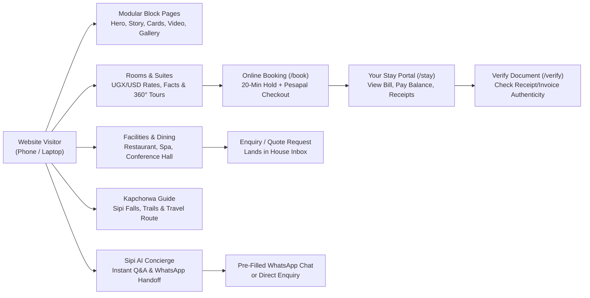
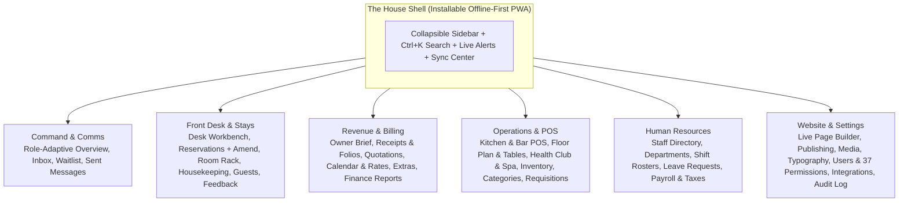
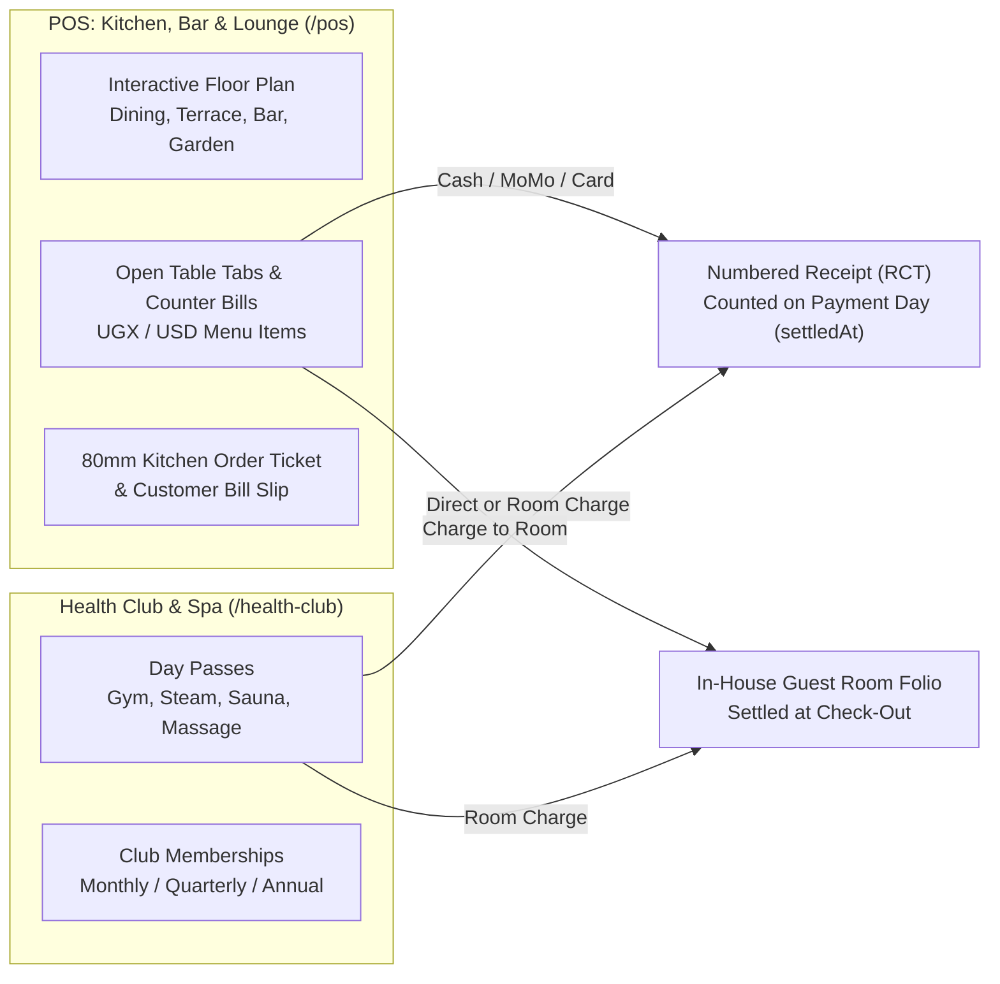

# REBERON HOTEL SUITE
## Official System Handover, Master Feature Manual & Public Launch Readiness Dossier

---

| Document Control | Details |
| :--- | :--- |
| **Prepared For** | **Mr. Denis Mayamba** (Proprietor & Managing Director) & The Executive Leadership of **Reberon Hotel, Kapchorwa** |
| **Prepared & Engineered By** | **ECADEL GROUP LIMITED** — Software Engineering & Digital Hospitality Division ([ecadelgroup.com](https://ecadelgroup.com)) |
| **Property Location** | Kapchorwa Town, Slopes of Mount Elgon (1,900 m), Eastern Uganda |
| **Official Public Website** | `https://reberonhotel.com` |
| **The House (Staff & Owner PMS)** | `https://reberonhotel.com:8443` |
| **Document Date** | November 2026 |
| **Launch Readiness Status** | **CERTIFIED READY FOR PUBLIC LAUNCH (100% Built, Deployed & Verified on Production)** |

---

## Executive Handover Statement from ECADEL GROUP LIMITED

Dear **Mr. Denis Mayamba** and the **Reberon Hotel Leadership Team**,

**ECADEL GROUP LIMITED** is proud to formally present the completed **Reberon Hotel Suite**—a bespoke, enterprise-grade Unified Hotel Operating System (UHOS), Guest Experience Website, Point-of-Sale (POS), Financial Accounting Engine, and Offline-First Management Platform built specifically for **Reberon Hotel**.

Every module envisioned for the property—from the public storytelling website and the **Sipi AI Concierge** to the **Front Desk workbench**, **Room Rack**, **Housekeeping mobile board**, **Kitchen & Bar POS with interactive floor plans**, **Health Club & Spa register**, **Store & Linen inventory**, **Human Resources & Uganda statutory payroll**, **Owner Financial Briefings**, and **Full Offline PWA resilience**—has been engineered, tested, deployed to your production server, and verified live.

We hereby certify that **Reberon Hotel Suite is officially ready for public launch.**

---

## 1. Public Launch Readiness Certification & Go-Live Checklist

> **LAUNCH CERTIFICATION:** All three core production services—the **Public Guest Website**, **The House Management Platform (PMS/POS)**, and the **Central API & Database Engine**—are active, secured with SSL/TLS encryption, backed by automated database integrity constraints, and running live on production infrastructure.

### 1.1 Live Production Environment Status

| System Component | Production Address / Unit | Status | Verification & Readiness Notes |
| :--- | :--- | :--- | :--- |
| **Public Guest Website** | `https://reberonhotel.com` (`reberonhotel-web.service`) | **LIVE (200 OK)** | Public pages, rooms, facilities, Kapchorwa guide, Sipi AI Concierge, enquiry forms, waitlist, stay lookup (`/stay`), and receipt verification (`/verify`) are active. |
| **The House (PMS, POS & Admin)** | `https://reberonhotel.com:8443` (`reberonhotel-admin.service`) | **LIVE (200 OK)** | Installable Offline-First PWA. Front Desk, Reservations, Room Rack, Housekeeping, POS, Health Club, Inventory, Requisitions, Quotations, HR, Finance Reports, and CMS are active. |
| **Central API & Transaction Engine** | Internal Port `4400` (`reberonhotel-api.service`) | **LIVE (Healthy)** | NestJS modular API connected to PostgreSQL 16 (`db: true`) and Redis 7 (`redis: true`) with 24-hour idempotency protection. |
| **Database & Schema Migrations** | PostgreSQL 16 (`reberonhotel`) | **100% Applied** | All 77 data models and 18 production schema migrations applied, including double-booking exclusion constraints and gap-free document numbering. |
| **Offline & Highland Resilience** | Service Worker (`sw.js`) + IndexedDB Outbox | **ACTIVE** | All 45 staff screens preload automatically on sign-in. Desk, POS, and Housekeeping continue operating during internet drops and sync automatically upon reconnection. |

### 1.2 The Five Engineering Guarantees Built Into Reberon Hotel

1. **100% Owner-Controlled Content (Zero Hard-Coding):** Every headline, story, photo, room price, facility detail, FAQ, navigation link, font choice, and guest message template on the public website is controlled directly from **The House**. You never need to call a developer to change wording, upload new photos, or adjust prices.
2. **Highland Offline-First Continuity:** Engineered for Kapchorwa's connectivity realities. If the internet drops, staff can still open every screen in The House, check guests in and out, mark rooms clean, and ring up food and drinks at the POS till (printing a provisional slip). When the connection returns, every queued action replays automatically—and the server's 24-hour idempotency guard guarantees **nothing is ever double-charged or double-booked**.
3. **Unbreakable Financial & Dual-Currency Discipline:**
   - **UGX and USD Never Mix:** Every price, bill line, payment, POS order, and report stores `UGX` and `USD` separately in exact units with zero silent currency conversion.
   - **Append-Only Guest Bills:** Once a charge or payment is posted to a guest folio, it can never be silently edited or deleted. Corrections post a transparent adjustment or reversal line.
   - **Immutable Numbered Documents:** Receipts (`RCT`), Refund Notes (`RFD`), Invoices (`INV`), and Quotations (`QUO`) are numbered sequentially without gaps and sealed with a verification check code.
4. **Database-Enforced Double-Booking Immunity:** PostgreSQL exclusion constraints make it mathematically impossible for two guests to be assigned the same physical room on overlapping nights, or for two online bookings to take the last room of a category simultaneously.
5. **Bank-Grade Security & Per-Person Access:** Staff permissions are configured per individual (37 distinct permissions), with optional sign-in time windows (e.g., `07:00–19:00` Kampala time) and access expiry dates. Guest ID numbers and third-party API keys are encrypted at rest with **AES-256-GCM**.

### 1.3 Owner-Controlled Go-Live Switches (No Developer Required)

The system is designed so that you can launch the public website, enquiries, waitlist, and full on-premise hotel operations **today**, while flipping on external payment and messaging rails whenever your commercial accounts are ready:

| Feature / External Rail | Current State | How the Owner Switches It On |
| :--- | :--- | :--- |
| **Public Website, Enquiries, Waitlist & Sipi AI Concierge** | **ON (Live Now)** | Active at `https://reberonhotel.com`. Enquiries and waitlist sign-ups land straight in **The House → Inbox & Waitlist**. |
| **Full On-Premise PMS, Front Desk, POS, Spa, Inventory & HR** | **ON (Live Now)** | Active at `https://reberonhotel.com:8443` for all staff roles. |
| **Online Self-Booking & Card/MoMo Checkout (`/book`)** | Built & Ready (Owner Toggle) | Enter Pesapal merchant keys in **Settings → Integrations**, verify rates in **Calendar & Rates**, and flip on **"Online Booking"** in **Settings → Features**. |
| **360° Interactive Virtual Tours** | Built & Ready (Owner Toggle) | Pre-loaded with image-walk tours; flip on **"Virtual Tours"** in **Settings → Features** whenever you want guests to walk the rooms online. |
| **Automated Email Confirmations & 19:00 Owner Brief** | **ON (Live)** | Configured via **Settings → Integrations → Email (SMTP)**. |
| **Automated SMS Alerts & Guest Stay OTPs** | Built & Ready (Fallback Active) | Enter Africa's Talking credentials in **Settings → Integrations**. Until connected, messages safely queue in **Sent Messages** for manual sending. |
| **Automated WhatsApp Business API** | Built & Ready (Click-to-Chat Active) | Enter Meta WhatsApp Cloud API keys in **Settings → Integrations**. Until connected, every message generates a one-tap **Send via WhatsApp (`wa.me`)** link for desk staff. |
| **VAT Breakdown on Receipts & Invoices** | Built & Ready (Owner Toggle) | Toggle **"VAT Registered"** and enter TIN in **Settings → General & Receipts** whenever applicable. |
| **Training / Demo Data Cleanup** | Ready | Demo bookings and sample guests are tagged internally (`isDemo`) so staff can practice safely and the database can be purged of demo records in one step. |

---

## 2. Part I — The Public Guest Website (`https://reberonhotel.com`)

The public website is a fast, mobile-first digital storefront designed to capture the atmosphere of Mount Elgon and convert visitors into direct bookings and enquiries without OTA commission fees.

### 2.1 Block-Based Visual Page System (27 Block Variants)
Every page on the website (Home, About, Dining, Conferences, Contact, Legal, or any new custom page created by staff) is composed of modular blocks arranged in **The House**:
1. **Hero Block:** Full-bleed or split layout with eyebrow badge, display headline, subtitle, primary/secondary action buttons, and background image or video.
2. **Story Block:** Editorial two-column narrative with pull-quotes, drop-caps, and supporting photography.
3. **Stats Strip:** Key property figures (e.g., *1,900m Elevation*, *10 Highland Suites*, *15 Min to Sipi Falls*, *100% Elgon Arabica*).
4. **Features Grid:** Icon-badged highlight cards showcasing hotel advantages.
5. **Cards Block (ADR-032):** Flexible multi-purpose section supporting three layouts—**Grid**, **Horizontal Carousel**, or **Text-Over-Image Overlay Cards**—with per-card badges, icons, images, descriptions, and links.
6. **Video Block (ADR-032):** Privacy-first, zero-bloat video showcase supporting **YouTube**, **Vimeo**, or **Direct Uploaded MP4/WebM** files with custom poster image, title, and caption. Loads zero external scripts until the guest clicks play.
7. **Room Grid Block:** Live-linked showcase of all published room types with capacity, bed type, view badge, starting rate (switchable between UGX and USD), and instant booking/enquiry links.
8. **Room Spotlight Block:** Deep-dive feature on a signature suite (e.g., *Summit Suite* or *Elgon View King*).
9. **Facilities Showcase Block:** Interactive overview of hotel facilities (Dining, Health Club & Spa, Gardens, Conference Hall) linked to their dedicated detail pages.
10. **Photo-Book Gallery Block (ADR-032):** Supports **Masonry**, **Filmstrip**, or **Mosaic** layouts with category filtering and full-screen lightbox. Displays only authentic per-photo captions, alt text, and photographer credits from the Media Library.
11. **Hotel Rising Timeline Block:** Chronological construction and property milestone feed with honesty badges.
12. **Destination Cards Block:** Highlights of Kapchorwa and Mount Elgon attractions.
13. **Journey / Getting Here Block:** Step-by-step route guide from Entebbe/Kampala via Jinja and Mbale to Kapchorwa, with distances, road surface notes, and travel times.
14. **Seasons & Climate Block:** Month-by-month guide to visiting Kapchorwa (dry trekking months, coffee harvest season, waterfall volume).
15. **Quote / Editorial Pull-Quote Block:** Highlighted statement with attribution.
16. **Questions (FAQ) Block:** Grouped expandable accordions for common guest questions.
17. **Contact Card & Map Block:** Direct phone, WhatsApp, email, physical address, reply-time promise, and interactive location map pin.
18. **Enquiry Form Block:** Validated contact form (Name, Email/Phone, Dates, Subject, Message, WhatsApp opt-in) that creates a live conversation in **The House Inbox** and sends an automatic acknowledgement to the guest.
19. **First-Stay Waitlist Form Block:** Captures earlybird and peak-season reservation requests (Name, Phone, Email, Preferred Dates, Room Type, Party Size, Notes).
20. **Call-to-Action (CTA) Band:** High-contrast conversion banner at the foot of pages.
21. **Live Weather Strip:** Current Kapchorwa highland temperature and conditions at 1,900 m.
22. **Guest Voices (Testimonials) Block:** Verified guest reviews approved by the owner from post-stay feedback.
23. **Virtual Tour Block:** Embedded 360° interactive walkthrough for a chosen hotel space.
24. **Packages & Experiences Block:** Curated stay packages and add-on excursions with transparent UGX/USD pricing.
25. **Rich Text & Spacer Blocks:** Formatted long-form prose (for policies/terms) and adjustable vertical breathing room.

### 2.2 Rooms & Suites Showcase (`/rooms`, `/rooms/[slug]`)
- **Complete Room Facts:** Sleeps count (adults/children), bed configuration, room size in square meters (`m²`), floor level, and view orientation.
- **Instant Currency Switcher:** Guests toggle between **UGX** and **USD**; every room rate, package, and extra updates immediately without conversion guesswork.
- **Amenities & Gallery:** Icon-mapped room amenities, multi-photo gallery, and honest labelling if a pre-opening architectural render is shown.
- **Direct Conversion Actions:** *"Book This Room"*, *"Enquire on WhatsApp"* (pre-filled with the exact room name), or *"Walk This Room (360° Tour)"*.

### 2.3 Facilities & Venue Pages (`/facilities/[slug]`)
- Dedicated pages for every major hotel venue (e.g., *Kitchen & Panorama Restaurant*, *Lounge & Bar*, *Health Club, Steam & Sauna*, *Conference & Banquet Hall*).
- **Database-Driven Details (ADR-032):** Quick-fact chips (opening hours, capacity, dress code), key highlights, photo gallery, and tailored action buttons (*Reserve a Table*, *Book a Day Pass*, *Request a Conference Quotation*) are all edited in **The House → Website → Facilities**.

### 2.4 Kapchorwa & Sipi Falls Regional Guide (`/kapchorwa`, `/kapchorwa/[slug]`)
- Positions Reberon Hotel as the authoritative gateway to Mount Elgon.
- Detailed pages for **Sipi Falls (all 3 waterfalls)**, **Mount Elgon National Park hikes**, **Arabica Coffee "Seed-to-Cup" tours**, **High-Altitude Running Trails** (home of Ugandan world champions), and **Cultural Experiences**, complete with distance from the hotel, difficulty level, duration, and what to pack.

### 2.5 Sipi AI Concierge (`/concierge` & Floating Assistant)
- Available on every page via the floating concierge button or dedicated `/concierge` page.
- Answers guest questions 24/7 using live hotel data: room types, rates, dining, spa facilities, directions from Kampala/Kenya, and Sipi Falls activities.
- **Interactive Trip Planner:** Guests can select their arrival/departure dates and party size inside the concierge to check room options or hand off the conversation directly to the Front Desk via WhatsApp or the House Inbox.

### 2.6 Online Booking & Payment Engine (`/book`, `/book/return`)
1. **Search:** Select check-in date, check-out date, adults, children, and currency (`UGX` or `USD`).
2. **Select Room & Rate Plan:** Shows only rooms with true physical availability across every night of the stay, alongside rate plans (e.g., *Bed & Breakfast*, *Room Only*, *Long Stay*) and clear cancellation policy terms.
3. **Add Extras & Packages:** Optional airport/Mbale transfers, guided waterfall walks, extra beds, or curated stay packages.
4. **Guest Details & 20-Minute Hold:** Entering guest details places an **atomic 20-minute inventory hold** on the room so no other guest can take it while payment is being completed.
5. **Pesapal Payment & Confirmation:** Redirects to Pesapal for **Mobile Money (MTN / Airtel)** or **Card (Visa / Mastercard)**. Upon payment verification, the booking converts to `CONFIRMED`, issues a numbered Receipt (`RCT`), emails the confirmation and receipt to the guest, and alerts the Front Desk in real time.

### 2.7 Guest Self-Service Portal — "Your Stay" (`/stay`)
- Guests access their booking anytime using their **Booking Code (`RB-XXXXX`)** and **Phone Number** (with optional one-time SMS/Email verification code).
- Displays full stay summary, assigned room, check-in/out times, live itemized bill, payments made, and remaining balance.
- Guests can **pay their remaining balance online**, **download/print official Receipts (`RCT`) and Invoices (`INV`)**, request extras, or **submit their stay feedback**.

### 2.8 Public Document Verification Portal (`/verify`)
- Any guest, corporate client, or auditor holding a Reberon Hotel document can visit `/verify` (or scan the document's QR code) and enter the **Document Number** (e.g., `RCT-2026-00001` or `INV-2026-00001`) and **8-character Check Code**.
- Confirms immediately whether the document is **Genuine (Active)** or **Voided**, displaying the issue date, guest name, and exact amount.

---

## 3. Part II — The House Management Platform (`https://reberonhotel.com:8443`)

**The House** is the private, role-adaptive operating system for Reberon Hotel staff, managers, and proprietors. Every staff member sees only the navigation items, workspaces, and actions permitted by their individual access profile.

---

### 3.1 Command & Comms — Role-Adaptive Dashboard (`/`)

 Rather than cluttering every employee's screen with executive charts, the home screen adapts automatically to the signed-in user:

#### A. Owner & Executive Overview
- **Compact KPI Ribbon:** Instant scannable metrics with one-click drill-downs:
  - *Cleared Revenue Today* (`UGX` / `USD`)
  - *POS & Health Club Revenue* (with open bill count)
  - *Store & Inventory* (total SKUs + low-stock warning badge)
  - *Inbox & Waitlist* (open threads + new requests)
  - *Front Desk Today* (in-house guest count + arrivals/departures)
  - *Confirmed Reservations*
  - *Staff & Rosters* (active staff count)
- **Needs Attention Queue:** Highlights only actionable exceptions (e.g., arriving guest whose room is still dirty, overdue departures, low-stock items, pending requisitions, unread guest enquiries).
- **Compact Room Rack Strip:** One-line visual status of all rooms on property (`101` to `205`) with colour-coded state dots, arrival/departure icons, and one-tap **Mark Clean** for dirty vacant rooms.
- **Live Operational Boards:** Front Desk live movement (`Arrivals`, `In-House`, `Departures`), Room Readiness & Occupancy bar, and Housekeeping cleaner load.

#### B. Front Desk, Barista & Operational Staff Workspace
- **Quick Actions Grid:** Large, one-click daily tool launchers (`+ Walk-In / Booking`, `Front Desk & Check-In`, `Housekeeping Queue`, `Room Rack`, `POS: Kitchen & Bar`, `Health Club & Spa`, `Guest Inbox`, `Store Requisitions`, `Receipts & Folios`).
- **Focused Workbenches:** Direct inline benches for checking in arriving guests, settling folios, marking rooms clean, replying to guest enquiries, and reading pinned shift handover announcements.

#### C. Shell Ergonomics & Navigation
- **Collapsible Full-Screen Sidebar:** Staff can collapse the left navigation sidebar with one click (or expand it anytime) to maximize screen space for POS, Front Desk, or Financial Reports; the state persists across the session.
- **Quick Jump Search (`Ctrl/Cmd + K`):** Instant keyboard-driven search to jump to any screen, reservation, or guest.
- **Theme & Sound Controls:** One-click Light/Dark mode toggle and audible notification chime toggle.

---

### 3.2 Front Desk & Stays

#### 1. Front Desk Workbench (`/desk`)
Designed for speed at reception with 56 px touch-friendly buttons and deep-linkable tabs (`Arrivals`, `In-House`, `Departures`, `Late / Overdue`):
- **Check-In Dialog:**
  - Suggests available **Vacant Clean** or **Inspected** rooms matching the booked room type.
  - Captures guest **ID / Passport Type, Country, and Number** (encrypted with AES-256-GCM in the database; only the last 4 digits are ever shown on screen).
  - Records optional check-in payment (Cash, Mobile Money, Card, Bank) and issues an immediate numbered Receipt (`RCT`).
- **In-House Stay Management (`StayPanel`):**
  - View the guest's complete itemized folio (room nights, POS transfers, spa passes, extras, taxes, payments, and balance).
  - **Add Charge / Credit:** Post laundry, transport, minibar, F&B, or manager-authorized goodwill adjustments.
  - **Move Room:** Transfer an in-house guest to another clean room of the same category; automatically marks the vacated room as `VACANT_DIRTY` and creates a housekeeping turnover task.
- **Check-Out Dialog:**
  - Verifies zero balance before check-out (or requires explicit Manager/Owner override to close a folio with an outstanding receivable balance).
  - Handles early departures cleanly.
  - Captures quick **Stay Sentiment (`Good`, `OK`, `Not Good`)** and notes.
  - Issues the final gap-free **Tax Invoice (`INV-YYYY-NNNNN`)**, releases the room assignment, flips the room to `VACANT_DIRTY`, and triggers a priority housekeeping departure-clean task.
- **Walk-In Bookings & No-Shows:**
  - Rapid walk-in creation that books, assigns a room, and checks the guest in within 90 seconds.
  - **No-Show Processing:** Marks overdue arrivals as `NO_SHOW`, calculates any applicable no-show fee per the booking's cancellation policy, releases the remaining nights back into saleable inventory, and logs the audit trail.

#### 2. Reservations & In-Place Amendment Engine (`/reservations`, `/reservations/new`, `/reservations/[id]`)
- **Complete Reservation Directory:** Filter by status, date range, source channel (`WEBSITE`, `WHATSAPP`, `PHONE`, `WALK_IN`), or guest name/code. Print or export the reservation list to Excel/CSV/PDF.
- **New Reservation Screen (`/reservations/new`):**
  - Live availability and price lookup across all room types and rate plans.
  - Choose booking mode: **Confirm Immediately** (with or without deposit), **Confirm & Collect Payment Now** (Cash, MoMo, Card, Bank), or **Place Temporary Hold** (with customizable hold duration and payment link).
  - **Manager/Owner Discounting:** Authorized staff (`payments:refund`) can apply a fixed or percentage discount during booking, posted transparently as an `ADJUSTMENT` folio line.
- **In-Place Reservation Amendments (ADR-027, `AmendDialog`):**
  - Edit arrival date, departure date, adult/child count, or room category directly on an existing reservation—**without cancelling and rebooking** (preserving the booking code, payment history, receipts, and assigned room where possible).
  - **Dry-Run Policy Preview (`preview: true`):** Before saving, the system runs the amendment inside a rolled-back database transaction and displays the exact night-by-night price difference and new folio balance.
  - **Frozen Price Protection:** Nights that were already booked keep their original agreed price by default (unless the desk ticks *"Re-price all nights at current rates"*).
  - **Append-Only Folio Integrity:** Amending a stay never overwrites past folio lines; it appends clear correcting lines (`Added night`, `Night removed`, or rate adjustment lines).
  - **In-House Amendment Guardrails:** For guests already checked in, arrival date is locked; extending a stay checks whether their current physical room is promised to another arriving guest and refuses conflicts automatically.
- **Hold Management:** One-click **Confirm Hold (No Deposit)** or **Extend Hold** (+2 hours / +24 hours) directly from the reservation detail page.

#### 3. Interactive Room Rack (`/rack`)
- Visual floor-by-floor status board of all physical rooms (`Room 101` through `Room 205`).
- Shows housekeeping state (`Vacant Clean`, `Vacant Dirty`, `Occupied`, `Inspected`, `Out of Order`), current guest name, departure-today indicator, arriving-today guest name, and maintenance block details.
- **Take Room Off Sale (Maintenance Block):** Block a room for a date range with a reason (e.g., *Plumbing check*, *Deep carpet clean*, *VIP painting*). The database atomically checks `InventoryDay` across every night of the block and refuses the block if it would cause an oversell against existing confirmed bookings.

#### 4. Housekeeping Board (`/housekeeping`)
- **Phone-First Interface:** Designed for housekeeping staff carrying smartphones on the floor.
- **Priority Queueing:** Departure cleans and rooms with an arriving guest due today are automatically pinned to the top with a high-visibility badge.
- **3-Step Workflow:** `TODO` ➔ `IN_PROGRESS` (Start Clean) ➔ `DONE` (Mark Clean) ➔ `INSPECTED` (Supervisor Sign-off).
- **Stay-Over Tidies:** Daily stay-over cleaning tasks with a one-tap *"Guest Declined Service Today"* option.
- **Privacy by Design:** Housekeeping screens never expose room rates, folio balances, or guest phone numbers/emails.

#### 5. Guest Profiles & Duplicate Merger (`/guests`, `/guests/[id]`)
- **Single Guest Identity (ADR-017):** Every enquiry, waitlist entry, WhatsApp chat, and reservation links to a unified `Contact` record.
- Tracks total stays, total nights, lifetime spend (separated by `UGX` and `USD`), VIP status, preferred room number, dietary requirements, and private staff notes.
- **Returning Guest Recognition:** Automatically badges returning guests at the Front Desk (*"2nd Stay"*, *"VIP"*).
- **Duplicate Detection & One-Click Merge:** Automatically flags potential duplicate profiles sharing a phone number or email (e.g., *Grace Chebet*) and merges all historical stays, folios, and messages into a single profile.

#### 6. Guest Feedback & Website Voices (`/feedback`)
- Collects guest ratings (`GOOD`, `OK`, `NOT_GOOD`) and comments from check-out or the `/stay` portal.
- Anything rated `OK` or `NOT_GOOD` enters the **Follow-Up Queue** until a manager records resolution action notes.
- Positive reviews where the guest ticked *"May quote on website"* can be published by the owner directly to the website's **Guest Voices** block with one click.

---

### 3.3 Operations, POS, Health Club & Inventory

#### 1. POS: Kitchen, Bar & Interactive Floor Plan (`/pos`, `/pos/tables`)
- **Visual Floor Plan & Table Management (ADR-026):**
  - Switch between **Floor View** and **Menu / Till View**.
  - Tables are grouped by zone (*Main Dining*, *Terrace*, *Lounge & Bar*, *Garden*, *Poolside*) showing seat capacity, live occupancy state (`Available` vs. `Occupied`), current bill total, and how long the table has been open.
  - Clicking an available table opens a new bill linked to that table; clicking an occupied table opens its active bill to add rounds or settle.
  - Owners and managers can add, rename, resize, change zones, or deactivate tables anytime at `/pos/tables`.
- **Multi-Outlet Menu & Categories:**
  - Supports **Restaurant**, **Bar**, **Pool Bar**, and **Room Service** outlets with category filtering, search, item modifiers/notes, and owner/manager menu item creation & price editing.
- **Order, Kitchen Ticket & Settlement Workflow:**
  - Add items to a new or existing open tab; print **80mm Kitchen/Bar Order Tickets** or **Customer Pre-Settlement Bill Slips**.
  - **Settle Bill (`SettleDialog`):** Accept **Cash**, **Mobile Money**, **Card**, **Bank Transfer**, or **Charge to Room Folio** (selects from currently checked-in rooms and posts the bill directly to the guest's stay folio).
  - **Payment-Day Revenue Recognition (`PosOrder.settledAt`):** A tab opened on Monday evening and paid on Tuesday morning is accurately counted in Tuesday's shift and financial takings.
- **Shift Summary & Z-Report (`ShiftDialog`):**
  - View total settled sales for any date/time window broken down by payment rail (`Cash`, `MoMo`, `Card`, `Bank`), room-folio transfers, outlet, and top-selling items, with one-click print.
- **Offline POS Continuity (ADR-030):**
  - If internet connectivity drops, the POS continues ringing up and settling orders without interruption, printing a **Provisional Slip** for the guest and issuing the official numbered receipt (`RCT`) automatically when the connection resumes.

#### 2. Health Club & Spa (`/health-club`)
- **Day Passes & Wellness Access Log:**
  - Check in walk-in guests or in-house hotel guests for **Gym**, **Steam & Sauna**, **Spa / Massage**, or **Full Day Pass**.
  - Record payment in `UGX` or `USD` (Cash, MoMo, Card) or charge directly to an in-house guest's room folio.
- **Memberships Register:**
  - Enrol local residents and regular guests into **Monthly**, **Quarterly**, or **Annual** Health Club memberships, tracking start/end dates, fee paid, membership status, and one-tap member check-ins.

#### 3. Store, Inventory, Linen & Item Categories (`/inventory`, `/inventory/categories`)
- **Item Categories (`/inventory/categories`):** Organize stock into structured categories (e.g., *Kitchen Dry Store*, *Beverages & Spirits*, *Guest Room Linen*, *Health Club Towels*, *Bathroom Amenities*, *Cleaning Supplies*).
- **Inventory & Linen Control (`/inventory`):**
  - Real-time stock balance, unit (`pcs`, `kg`, `litres`, `bottles`, `sets`), reorder/par threshold, and unit cost in `UGX`.
  - **Stock Movements:** Record **Purchases / Deliveries (+)**, **Department Issues (-)**, **Waste / Breakage (-)**, **Laundry Out / Return**, and **Physical Stocktake Adjustments** with full user attribution and notes.
  - **Low-Stock Alerts:** Items at or below par level automatically trigger red low-stock badges on the sidebar and Owner Dashboard.

#### 4. Department Requisitions & Team Comms (`/requisitions`)
- **Store Requisition Workflow:**
  - Kitchen, Bar, Housekeeping, or Front Desk staff submit a digital stock requisition listing required items and quantities.
  - Managers/Storekeepers review pending requests (`PENDING` ➔ `APPROVED` ➔ `ISSUED` or `REJECTED`), automatically deducting issued quantities from central inventory.
- **Pinned Team Announcements & Shift Handover:**
  - Broadcast operational reminders (e.g., *Strict separation of moss-trimmed Gym Towels vs. white 650 GSM Guest Room Bath Sheets*) or shift handover notes targeted to `ALL_HOUSE` or specific departments (`FRONT_DESK`, `HOUSEKEEPING`, `KITCHEN_BAR`).

---

### 3.4 Revenue, Billing & Owner Financial Intelligence

#### 1. Quotations & Events (`/quotations`)
- Create professional, numbered quotations (`QUO-YYYY-NNNNN`) for corporate retreats, conferences, weddings, and group stays.
- Add multiple line items (accommodation nights, conference hall hire, projector/PA package, buffet meals, tea breaks, guided walks) in `UGX` or `USD`, with tax and discount calculations.
- Track status (`DRAFT`, `SENT`, `ACCEPTED`, `DECLINED`, `EXPIRED`) and print/download branded A4 Quotation documents.

#### 2. Receipts, Refund Notes & Invoices (`/receipts`)
- Central immutable register of all issued `RCT`, `RFD`, and `INV` documents.
- View, reprint (automatically watermarked `COPY`), download A4 or 80mm thermal format, send to guest, or **Void & Reissue** with mandatory audit reason.

#### 3. Owner Brief (`/brief`) & Automated 19:00 Daily Briefing
- Executive summary page designed for the Proprietor:
  - Tonight's occupancy, rooms occupied vs. available, arrivals expected tomorrow, and departures tomorrow.
  - Today's cleared cash inflow and recognized revenue by currency (`UGX` and `USD`).
  - **Insights & Exceptions (`BriefInsights`):** Highlights unpaid departed folios, expiring holds, low stock, and pending leave/requisition approvals.
  - **Automated 19:00 Email + Manual Trigger:** Sent automatically every evening at 19:00 Kampala time to owner recipients, with a **"Send Brief Now"** button for instant on-demand delivery.

#### 4. Financial Reports & Operating Expenses (ADR-028, `/reports`)
Engineered so that every number reconciles to the shilling and dollar across the entire hotel:
- **Earned Revenue (Accrual) vs. Collected Cash (Inflow):**
  - **Recognized Revenue:** Room revenue is counted on each night slept; POS, desk F&B, and Health Club sales are counted on the day settled; extras and cancellation/no-show fees are counted on their folio date; discounts, goodwill credits, and write-offs are tracked as **Allowances** reducing Gross Revenue to **Net Revenue**.
  - **Collected Cash:** Sums every actual payment rail (`CASH`, `MTN_MOMO`, `AIRTEL_MONEY`, `PESAPAL_CARD`, `POS_CARD`, `BANK_TRANSFER`) across Room Folios, non-folio POS bills, and Health Club, minus refunds. **POS bills charged to a room folio are never double-counted as cash.**
- **Period-Over-Period Comparisons:** Compare any selected date range against the **Previous Period** or **Same Dates Last Year** with percentage delta badges.
- **Hospitality KPIs:** Occupancy %, Average Daily Rate (**ADR**), Revenue Per Available Room (**RevPAR**), room nights sold, and channel mix breakdown.
- **Receivables Aging Schedule:** Lists every open guest/corporate balance aged by days past departure (`In-House`, `0–7 days`, `8–30 days`, `31–60 days`, `60+ days`) with direct links to the reservation folio.
- **VAT & Tax Schedule:** Computes the exact VAT portion contained within tax-inclusive sales.
- **Operating Expenses Panel (`ExpensesPanel`):** Record, categorize, filter, print, and export hotel operating expenses (utilities, supplier invoices, maintenance, fuel, marketing) to track net operating performance.

---

### 3.5 Human Resources, Rosters, Leave & Payroll (`/hr`, `/departments`)

- **Hotel Departments (`/departments`):** Manage operational departments (Front Office, Housekeeping, Kitchen & Bar, Health Club & Grounds, Management & Accounts).
- **Staff Directory (`/hr`):**
  - Complete employee profiles with photo/initials, job title, department, employment type (`FULL_TIME`, `PART_TIME`, `CONTRACT`, `CASUAL`), start date, salary, bank/Mobile Money payout details, and emergency contacts.
  - Supports both staff with system logins and non-login operational staff (cleaners, guards, gardeners).
- **Shift Rosters:** Schedule and review staff shifts (`MORNING`, `AFTERNOON`, `NIGHT`, `OFF`) across the week.
- **Leave Requests & Approvals:** Log staff leave applications, review overlapping department absences, and approve or decline with manager notes.
- **Payroll & Uganda Statutory Taxes:**
  - Generate monthly payroll runs calculating Basic Salary, Allowances, Advances/Deductions, **Uganda PAYE**, **NSSF Employee (5%)**, **NSSF Employer (10%)**, and **Net Pay**.
  - Approve and mark payroll records as paid, and print individual staff payslips or full payroll registers.

---

### 3.6 Unified Print & Export Suite (ADR-031)

Every operational and financial screen in The House shares a single, executive-grade print and export engine:
- **Branded A4 Letterhead Printing (`lib/print.ts`):**
  - Pressing any **Print** button (or `Ctrl/Cmd + P`) renders the table, report, or dialog inside a dedicated A4 print frame complete with the **Reberon Hotel Letterhead** (logo, hotel name, Kapchorwa address, phone, email), document title, subtitle/date range, who printed it and when, and automatic page numbers—cleanly omitting all sidebar menus, buttons, and search bars.
- **One-Click Export Menu (`ExportMenu` — Excel `.xlsx`, CSV & Branded PDF):**
  - **Excel (`.xlsx`):** Generates a genuine multi-styled Excel workbook directly in the browser (with letterhead header rows, styled column headers, frozen top row, auto-filters, real numeric cells formatted as `UGX #,##0` or `USD #,##0.00`, and separate currency total rows so UGX and USD are never summed together).
  - **CSV (`.csv`):** Clean UTF-8 data export with unformatted numbers for accounting software import.
  - **PDF (Print to PDF):** Opens the branded A4 letterhead view ready to save as PDF.

---

### 3.7 Website CMS, Live Page Builder & Brand Typography

- **Interactive Live Page Builder (ADR-032, `/website/pages/[id]`):**
  - **Click-to-Edit Preview Bridge:** The draft preview shows the real website inside the editor. Clicking any section on the preview opens that exact block in the editor; clicking a block in the editor scrolls the preview smoothly to it; saving updates the preview in place without reloading.
  - **Power Tools:** Undo / Redo history, Copy / Paste blocks between pages, searchable grouped block picker, version history with one-click restore, and a built-in **Page Check** that warns if SEO titles, descriptions, share images, or hero blocks are missing.
- **Curated Self-Hosted Typography Studio (ADR-033, `/settings`):**
  - Choose from **26 curated fonts** (Editorial Serifs, Humanist Sans, Geometric Sans, and Monospace) for both the **Public Website** and **The House**.
  - Customize heading font, body font, font weight, letter spacing, italic styling, and text size scale with a **live interactive preview** before saving.
  - All 26 fonts are self-hosted inside the application bundle—meaning **zero external calls to Google**, faster page loads for guests, and full font rendering even when The House is completely offline.

---

### 3.8 Security, Access Control, Integrations & Audit Log (`/settings/*`)

- **Per-Person Access Control (ADR-024, `/settings/users`):**
  - Start from a role preset (`Owner`, `Manager`, `Front Desk`, `Housekeeping`) and toggle any of the **37 individual permissions** on or off for that specific person.
  - Set **Allowed Sign-In Hours** (Kampala time) and an **Access Expiry Date** for temporary or relief staff.
  - View active signed-in devices and trigger **Sign Out Everywhere** immediately if a device is lost.
- **Encrypted Integrations Vault (ADR-020, `/settings/integrations`):**
  - Owner-only vault storing API keys for **Pesapal**, **Africa's Talking SMS**, **Meta WhatsApp Cloud API**, and **SMTP Email** encrypted with AES-256-GCM, with built-in **Test Connection** buttons.
- **Live Alert & Web Push Rules (`/settings/notifications`):**
  - Configure which staff roles receive pop-up, sound, and background Web Push notifications for Bookings, Payments, Front Desk movement, Housekeeping, POS, Inventory, and Enquiries.
- **Tamper-Evident Audit Log (`/settings/audit`):**
  - Every action in The House is permanently logged with timestamp, staff member, IP address, action type, and detailed before/after values.

---

## 4. Complete Architecture Decision Record (ADR-001 to ADR-033)

Every major engineering choice is documented and verified:
- **ADR-001 to ADR-005:** Monorepo architecture (`apps/web`, `apps/admin`, `apps/api`), Prisma + PostgreSQL 16, shared Zod contracts, in-house block CMS, and localizable JSONB text.
- **ADR-007:** Strict dual-currency (`UGX` / `USD`) minor-unit storage with zero silent conversion.
- **ADR-009 & ADR-024:** Argon2id authentication, rotating refresh tokens, 37 per-person permissions, sign-in time windows, and immediate permission enforcement.
- **ADR-017 & ADR-018:** Unified `Contact` guest profile with duplicate merge; PostgreSQL exclusion constraints preventing double-booked rooms and oversold maintenance blocks.
- **ADR-020 & ADR-021:** AES-256-GCM encrypted Integrations Vault and resilient message outbox with manual WhatsApp fallback.
- **ADR-022:** Slot-based 360° Virtual Tours with pre-opening image walk and live tour replacement.
- **ADR-025:** Gap-free immutable Receipts (`RCT`), Refund Notes (`RFD`), and Invoices (`INV`) with void-and-reissue workflow and cryptographic check codes.
- **ADR-026:** Managed POS tables (`PosTable`), interactive floor plan, and payment-time revenue recognition (`PosOrder.settledAt`).
- **ADR-027:** In-place reservation amendments (`POST /reservations/:id/amend`) with rolled-back dry-run preview, frozen rate protection, and append-only folio corrections.
- **ADR-028:** Unified Owner Finance engine (`FinanceService`) reconciling accrual revenue vs. collected cash rails, receivables aging, VAT extraction, and the 19:00 Owner Brief.
- **ADR-029 & ADR-030:** Installable Offline-First PWA, automatic preload of all 45 House routes, IndexedDB write outbox, Redis 24-hour idempotency interceptor, optimistic UI updates, offline POS provisional slips, and VAPID Web Push notifications.
- **ADR-031:** Unified A4 letterhead print engine (`lib/print.ts`) and zero-dependency native `.xlsx` / CSV / PDF export suite (`lib/export.ts`).
- **ADR-032:** Bidirectional Page Builder preview bridge (`postMessage`), Cards & lazy Video blocks, and database-driven `Facility.details`.
- **ADR-033:** Curated 26-font self-hosted typography studio (`appearance.typography`) for both Website and The House.

---

*Prepared with precision for **Reberon Hotel, Kapchorwa** by **ECADEL GROUP LIMITED** ([ecadelgroup.com](https://ecadelgroup.com)).*
