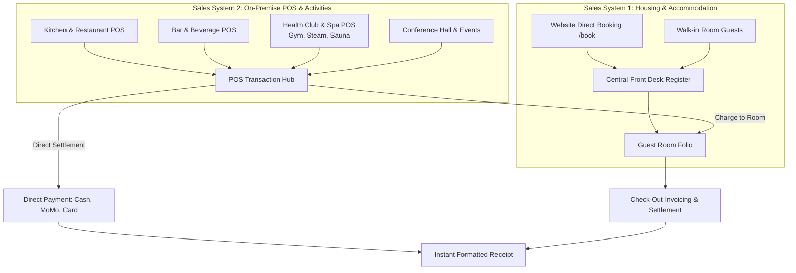
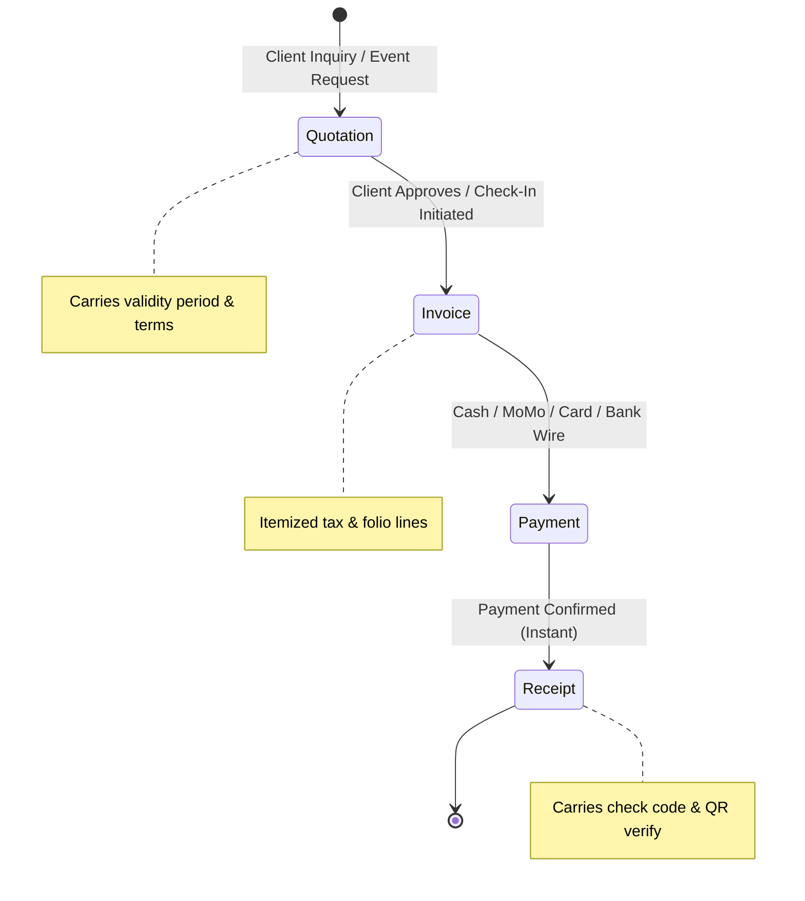
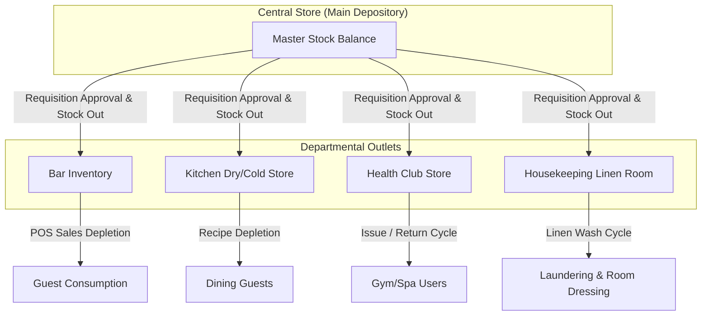
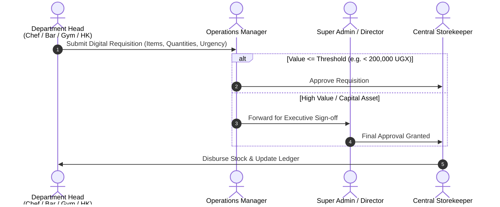
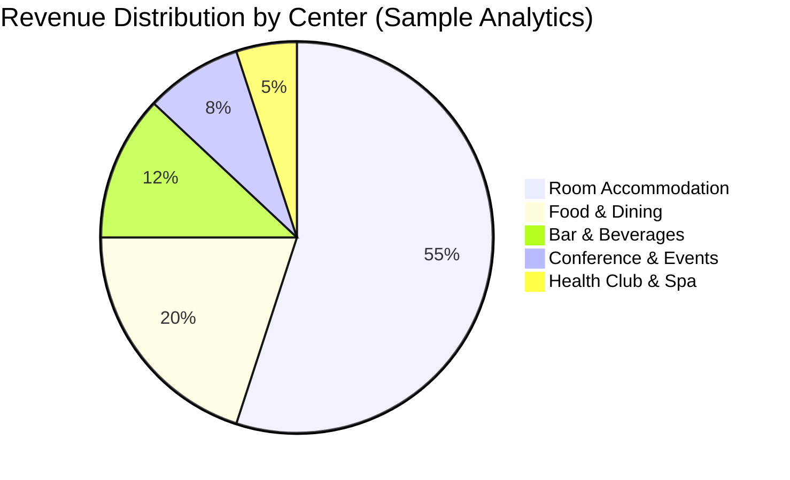
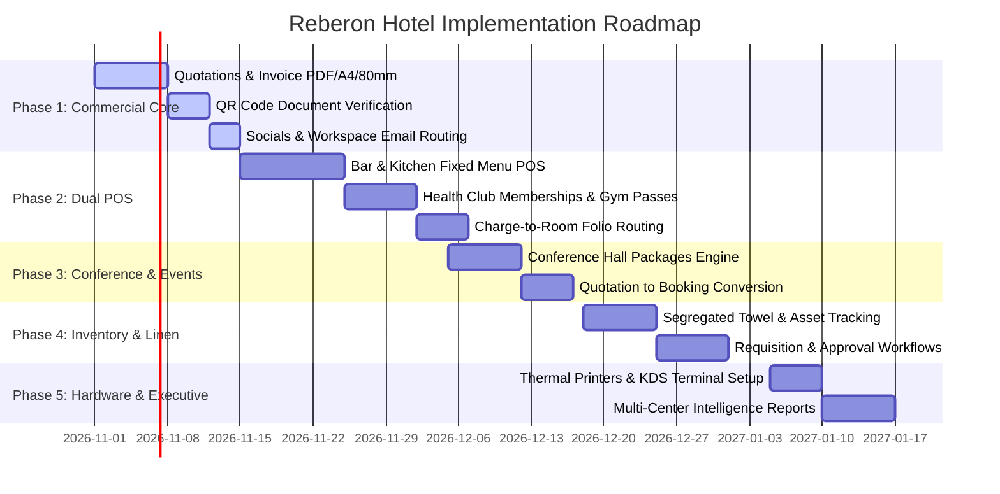

# Reberon Hotel — Master Operational Architecture & System Specification
## Unified Hotel Operating System (UHOS) & Commercial Platform

**Document Version:** 2.0 (Post-Meeting Complete Master Specification)  
**Author / Engineering Lead:** ECADEL GROUP LIMITED ([ecadelgroup.com](https://ecadelgroup.com))  
**Property:** Reberon Hotel, Kapchorwa, Mount Elgon, Uganda  
**Domain & Identity:** `reberonhotel.com`  
**Target Environments:** Web Portal (`apps/web`), The House Management Panel (`apps/admin`), Central API (`apps/api`)  
**Status:** Approved for Implementation

---

## 1. Executive Summary & Strategic Vision

Following the strategic planning sessions with the Reberon Hotel executive team, this document synthesizes all discussions, operational requirements, and functional specifications into a single, cohesive architectural blueprint.

Reberon Hotel is establishing itself as the premier highland luxury and eco-hospitality destination on the slopes of Mount Elgon in Kapchorwa. To deliver effortless guest experiences while maintaining airtight financial, operational, and inventory integrity, the technology stack is evolving from an online booking engine and desk register into a **Unified Hotel Operating System (UHOS)**.

### Core Philosophy
1. **Guest-Facing Simplicity:** Frictionless digital navigation, transparent package pricing, 360° virtual exploration, and instant multi-channel communication (WhatsApp, Email, Socials).
2. **Dual-Engine Sales Architecture:** Seamless coexistence between **Housing/Accommodation Sales** (Front Desk, Room Folios, Website bookings) and **On-Premise Point of Sale (POS)** (Kitchen, Bar, Health Club, and Conference Hall).
3. **Unbroken Commercial Pipeline:** Every shilling and dollar is accounted for via a strict four-stage audit lifecycle: `Quotation ➔ Invoice ➔ Payment ➔ Receipt`, backed by cryptographic verification check codes and scannable QR codes.
4. **Tight Operational & Inventory Guardrails:** Strict segregation of assets, dedicated linen cycles (Gym Towels vs. Room Towels), consumable tracking (slippers, shower caps, ropes), and a formal digital requisition hierarchy.
5. **Highland Resilience:** Engineered to function reliably in Kapchorwa, withstanding intermittent power and internet connectivity via local terminal caching and resilient sync.

---

## 2. Official Identity, Communications & Social Media Ecosystem

### 2.1 Domain & Email Infrastructure
The hotel operates strictly under the official brand domain: `reberonhotel.com`.

| Email Address | Purpose & Routing | Access Group |
|---|---|---|
| `director@reberonhotel.com` | Board matters, executive approvals, high-value corporate contracts | Super Admin / Hotel Directorate |
| `inquiries@reberonhotel.com` | General guest inquiries, website form submissions, group booking requests | Front Desk & Reservations Team |
| `reservations@reberonhotel.com` | Automated booking confirmations, stay reminders, folio statements | Automated System / Desk |
| `accounts@reberonhotel.com` | Quotations, pro-forma invoices, supplier payments, tax audits | Management & Accounting |
| `firstname.lastname@reberonhotel.com` | Individual staff and managerial accounts | Designated Staff Members |

*All email accounts are orchestrated through Google Workspace (Gmail integration) with SPF, DKIM, and DMARC enforcement to guarantee 100% deliverability for guest confirmations and invoices.*

### 2.2 Social Media Integration
The public website (`apps/web`) seamlessly bridges prospective travelers between social discovery and direct booking:
- **TikTok:** Short-form video highlights (sunrise over the Sipi ridge, barista coffee brewing, waterfall hikes) embedded on the homepage and Kapchorwa guide.
- **Instagram & Facebook:** Live gallery feeds, guest testimonials, and seasonal announcements.
- **Dynamic QR Codes:** Printed on all physical receipts, room keycards, dining menus, and invoice headers, routing guests directly to `@reberonhotel` socials or the `/verify` portal.

### 2.3 Virtual Tours Experience
- **Interactive 360° Walkthroughs:** Embedded directly in room type pages, conference hall overviews, and health club sections.
- **Pre-Visit Familiarization:** Enables wedding planners, retreat organizers, and international travelers to explore the property before committing deposits.
- **House-Controlled:** Toggled on/off via **Settings → Features** in the management platform.

---

## 3. The Dual Sales System Architecture

Reberon Hotel operates two interconnected sales engines unified under a central financial ledger and reporting hub:



---

### 3.1 Sales System 1: Housing & Accommodation

#### Guest Journey
1. **Discovery & Selection:** Clear room facts (occupancy, bed type, amenities, view) with real-time rate plans (Standard, Breakfast Included, Half Board).
2. **Booking Channels:**
   - **Online Booking Engine (`/book`):** Direct booking with automated 20-minute reservation holds during payment processing.
   - **Front Desk Walk-Ins:** Quick front-desk booking interface allowing receptionists to capture guest details, assign clean rooms, take deposits, and issue keys within 90 seconds.
3. **Guest Stay Hub (`/stay`):** Self-service portal accessible via booking code (`RB-XXXXX`) + phone number:
   - View arrival/departure dates, room assignment, and rate breakdown.
   - View itemized charges and pay remaining balance via Pesapal (Mobile Money MTN/Airtel or Credit/Debit Card).
   - View and print official booking vouchers and formatted receipts.
   - Submit real-time feedback during stay or upon departure.

---

### 3.2 Sales System 2: On-Premise POS (Consumables, Activities & Events)

#### A. Kitchen & Restaurant POS
- **Menu Management:** Structured digital menu (Breakfast, Lunch, Dinner, Snacks). *Note from team meeting: Currently operated as scheduled/set available menus; on-demand individual custom prep will be phased in later.*
- **Kitchen Order Routing:** Orders placed at the dining room or bar instantly transmit to the Kitchen Display System (KDS) or 80mm thermal kitchen ticket printer.
- **Settlement Modes:** Immediate cash/MoMo settlement or post to guest Room Folio with guest signature verification.

#### B. Bar & Beverage POS
- **Beverage Catalog:**
  - **Hot Beverages:** Highland Elgon Arabica coffee (Espresso, Cappuccino, Latte, Pour-over), local teas, herbal infusions.
  - **Cold Beverages:** Freshly pressed tropical juices, sodas, mineral waters.
  - **Alcoholic Selection:** Signature cocktails, craft & standard beers, fine wines, premium spirits, whiskeys, cognacs.
  - **Non-Alcoholic Cocktails:** Mocktails, fruit smoothies, tonics.
- **Operational Features:** Quick drink-repeat orders, bar tab tracking, direct bottle-to-glass recipe tracking for inventory deduction.

#### C. Health Club & Spa POS (Steam, Sauna, Gym)
The Health Club operates on a flexible, modular access model with a **single unified system**:

| Access Tier | Description & Entitlements | Billing Cycles | Included Amenities |
|---|---|---|---|
| **Gym Only** | Full access to strength and cardio equipment | Daily Pass, Monthly, Annual | Locker, 1 Gym Towel, Water |
| **Steam & Sauna Only** | Access to traditional steam room and dry sauna cabins | Daily Pass, 10-Session Pass, Monthly | Locker, 1 Gym Towel, Sandals, Shower Cap |
| **Full Health Club Combo** | Unlimited Gym + Steam + Sauna + Relaxation lounge | Daily Pass, Monthly Membership, Annual Pass | Locker, 2 Towels, Sandals, Shower Cap, Hot Tea |
| **Hotel Resident Guest** | Complimentary or discounted based on room rate plan | Stay Duration | Standard amenities |

- **Instructor & Attendant Terminal:** Tablet-optimized interface for gym instructors and spa attendants to:
  - Check in active members via name, phone number, or digital membership QR card.
  - Sell daily drop-in passes directly via cash or mobile money.
  - Issue and reconcile tracked amenities (gym towels, sandals, shower caps).

#### D. Conference Hall & Event Management
A dedicated sub-module for high-value meetings, workshops, banquets, and weddings:
- **Flexible Space Configurations:** Boardroom layout, theater style, classroom, banquet layout.
- **Activity-Based Packages:**
  - **Corporate Full-Day:** Hall hire + high-speed Wi-Fi + projector/PA system + 10:00 AM coffee break + buffet lunch + 4:00 PM tea.
  - **Corporate Half-Day:** Hall hire + 1 coffee break + buffet lunch.
  - **Social / Wedding Banquets:** Hall & grounds access + tables/chairs + stage + custom catering & bar package.
- **Commercial Flow:** Inquiries convert directly to formal Quotations with expiration dates and deposit schedules.

---

## 4. Commercial Transaction Pipeline: Quotation ➔ Invoice ➔ Payment ➔ Receipt

Every monetary transaction across Reberon Hotel adheres to an inviolable four-stage workflow:



### 4.1 Document Structure & Standards

1. **Quotations / Pro-Forma Estimates:**
   - Generated for conferences, group bookings, weddings, and extended stays.
   - Includes full breakdown of hall hire, food & beverage pax counts, room allotments, and audio-visual equipment.
   - States deposit milestones (e.g. 50% advance to secure date, 50% 48 hours prior to event).
   - Dynamic conversion: One-click conversion from Quotation into an active Reservation and Pro-Forma Invoice.

2. **Invoices:**
   - Formal legal document listing VAT (if registered), TIN, legal business entity (ECADEL GROUP LIMITED management notice), client details, itemized dates, room nights, and consumable charges.
   - Dynamic balance calculation: Total Charges less Advance Deposits = Balance Due.

3. **Payments:**
   - Dual-currency native support: Ugandan Shillings (`UGX`) and United States Dollars (`USD`). Minor units stored as `BigInt` to prevent floating-point rounding errors.
   - Supported tender methods: `CASH`, `MOBILE_MONEY_MTN`, `MOBILE_MONEY_AIRTEL`, `CARD_PESAPAL`, `BANK_TRANSFER`.

4. **Receipts (Formatted, Elegant & Verifiable):**
   - Available in two responsive formats:
     - **A4 Standard Document:** Official full-page receipt with company letterhead, border accents, and signature line.
     - **80mm Thermal Receipt:** Optimized for high-speed thermal printers at the front desk, bar, and kitchen.
   - **Verification Safeguards:**
     - Unique gap-free document number (e.g., `RCT-2026-00108`).
     - Cryptographic 8-character check code (e.g., `AB12-CD34`).
     - **Dynamic Verification QR Code:** Direct camera scan navigates to `https://reberonhotel.com/verify?number=RCT-2026-00108&check=AB12-CD34` validating authenticity instantly.

---

## 5. Inventory, Linen & Fixed Asset Control

To prevent shrinkage, ensure hygiene, and preserve operating margins, the system implements granular physical tracking:



---

### 5.1 Linen & Towel Segregation (Critical Mandate)
A core directive from the team meeting: **Gym Towels and Bathroom Towels must never be commingled.**

| Attribute | Gym Towels | Bathroom / Room Towels |
|---|---|---|
| **Location / Custody** | Health Club Desk & Gym Floor | Guest Rooms & Housekeeping Store |
| **Specifications** | Distinct brand border / color (e.g., Moss Green trim) | Luxury heavy-gauge white bath sheets |
| **Tracking Protocol** | Issued against member name or room number at gym desk | Placed in room according to room occupancy |
| **Return Reconciliation** | Scanned/checked into laundry hamper at exit | Counted during daily room refresh and check-out |
| **Loss Control** | Missing towel flagged to guest room folio if unreturned | Room inspection protocol prior to deposit refund |

### 5.2 Guest Consumables & Spa Accessories
Consumables are monitored through minimum par-levels with automated re-order alerts:
- **Disposable Accessories:** Shower caps, sanitised sandals/slippers, hygiene strips.
- **Gym Accessories:** Skipping ropes, resistance bands, yoga mats (issued and returned per workout session).
- **In-Room Vanity Amenities:** Bottled water, Elgon coffee sachets, artisan teas, organic soaps.

### 5.3 F&B Stock Control
- **Stock In:** Receiving goods from suppliers against purchase orders with unit pricing and expiration dates.
- **Stock Out:** Automated decrements triggered by POS transactions (e.g., selling 1 Tusker Lager decrements the bar stock count by 1).
- **Wastage & Spoilage Log:** Formal recording of broken bottles, expired dairy, or food prep waste requiring supervisor sign-off.

### 5.4 Fixed Asset Registry
Permanent property items are assigned QR/barcode tags and recorded in the House:
- **Gym Equipment:** Treadmills, spin bikes, multi-gym stations, dumbell racks (with maintenance schedules).
- **Conference Assets:** Projectors, wireless microphones, mixers, conference tables, executive chairs.
- **Kitchen & Bar Equipment:** Espresso machines, blenders, commercial refrigeration, ovens.

---

## 6. Internal Procurement, Requisitions & Departmental Communication

Operational efficiency relies on transparent internal requests without paper slips getting lost between departments.



### 6.1 Requisition Categories
1. **Stock Replenishment:** Dry store food, beverage crates, bar garnishes, coffee beans.
2. **Guest Supplies:** Towels, bathroom soaps, sanitizers, stationery, slippers.
3. **Cleaning & Sanitation:** Laundry detergent, disinfectant, pool/spa chemicals.
4. **Maintenance & Repairs:** Plumbing fittings, light bulbs, gym machine cables, sound equipment repairs.

### 6.2 Internal Communications Hub
- **Shift Logbook:** Front desk and duty managers log critical occurrences (e.g., late arrivals, dietary restrictions, special VIP requests).
- **Departmental Notes:** Direct communications attached to reservations or customer accounts (e.g., "Guest in Room 4 is celebrating an anniversary; send complimentary fruit basket from kitchen").
- **Broadcast Notices:** Urgent announcements visible to all signed-in staff (e.g., scheduled power maintenance, incoming tour group of 25 pax).

---

## 7. Device & Hardware Management

The software suite interfaces directly with standard hospitality hardware:

```
┌────────────────────────────────────────────────────────────────────────┐
│                        REBERON HARDWARE ECOSYSTEM                      │
├───────────────────┬───────────────────┬────────────────────────────────┤
│ Front Desk        │ Bar Terminal      │ Kitchen Station                │
│ • PC / All-in-One │ • Tablet / Touch  │ • Kitchen Display Screen (KDS) │
│ • A4 Page Printer │ • 80mm POS Printer│ • 80mm Thermal Ticket Printer  │
│ • 80mm Slip Print │ • Cash Drawer     │                                │
├───────────────────┼───────────────────┼────────────────────────────────┤
│ Health Club / Gym │ Housekeeping      │ Management & Back Office       │
│ • Android/iPad Tab│ • Mobile Web App  │ • Desktop / Laptop             │
│ • Bluetooth Scannr│ • Room Status Rack│ • Full Financial Reporting     │
└───────────────────┴───────────────────┴────────────────────────────────┘
```

1. **Kitchen Terminal:** Orders automatically route to the kitchen printer or touch screen, grouping by preparation station.
2. **Bar Station:** Fast cash-drawer integration and 80mm receipt generation.
3. **Front Desk Station:** Dual-printer setup: A4 for official Booking Vouchers, Invoices, and Quotations; 80mm thermal for quick guest transaction receipts.
4. **Health Club & Gym Station:** Lightweight tablet for gym instructors to register walk-ins and verify active memberships at the entrance.

---

## 8. Role-Based Access Control (RBAC) & Staff Hierarchy

The system enforces strict permission walls to guarantee financial confidentiality and operational clarity:

| Role | Screens & Capabilities | Financial Visibility | Permissions Guardrails |
|---|---|---|---|
| **Super Admin** *(Director / Owner)* | Full access to all modules, settings, feature toggles, audit logs, and integrations | Full: Gross revenue, profit margins, bank settlements | Master authority; can invite/disable users and override transactions |
| **Operations Manager** | Reservations, POS operations, inventory, approvals, staffing, reports | Operational revenue, daily takings, expense reports | Cannot alter core system settings or delete published pages |
| **Receptionist / Front Desk** | Room rack, bookings, check-in/out, stay lookups, quotations, invoices, receipts | Folios, deposits, room balances, daily desk cash | No access to global owner profit reports or system integrations |
| **Bar Attendant** | Bar POS, drink menus, bar tabs, daily beverage stock count | Bar session takings and bar stock values only | Cannot view room rates, guest ID numbers, or housekeeping data |
| **Kitchen Chef / Cook** | Kitchen Display System, food menu availability toggles, requisitions | Food cost requisitions only | No access to room folios, guest profiles, or financial reports |
| **Gym Instructor / Attendant** | Health club check-in, daily pass POS, towel issuance log, equipment status | Health club pass takings only | Cannot access accommodation data or bar tabs |
| **Housekeeping** | Room cleaning rack, maintenance flag, towel/linen counts, room amenities | None: Zero access to money, folios, or guest contact details | Sees room status (Clean, Dirty, Inspected) and guest arrival dates only |

---

## 9. Performance Tracking & Executive Intelligence (Reports)

The management platform provides automated reporting with exportable PDF and CSV capabilities:



### Key Executive Metrics
1. **Accommodation Intelligence:**
   - **Occupancy Rate (%)** and Average Length of Stay (ALOS).
   - **Average Daily Rate (ADR)** and Revenue Per Available Room (**RevPAR**).
   - Direct Website vs. Walk-In vs. Travel Partner channel breakdowns.
2. **Food & Beverage Intelligence:**
   - Daily dining and bar turnover.
   - Top-selling menu items and pour-cost percentages.
   - Food wastage and variance analysis.
3. **Health Club Intelligence:**
   - Daily drop-in volume vs. Active recurring monthly/annual memberships.
   - Peak usage hours (morning vs. evening) to optimize sauna heating schedules.
   - Towel return compliance rates.
4. **Inventory & Procurement Audits:**
   - Stock shrinkage / discrepancy reports between physical counts and system balances.
   - Departmental requisition expenditure vs. monthly budget caps.

---

## 10. Technical Architecture & Database Schema Additions

To support these capabilities without destabilizing the rock-solid foundations already built, the database schema (`packages/db/prisma/schema.prisma`) is extended with clean, relational models:

```prisma
// ────────────────── Point of Sale & Outlets ──────────────────

enum PosOutletType {
  KITCHEN
  BAR
  HEALTH_CLUB
  CONFERENCE
}

model PosOutlet {
  id          String        @id @default(uuid(7)) @db.Uuid
  code        String        @unique // e.g. "KITCHEN", "MAIN_BAR", "GYM_SPA"
  name        String
  type        PosOutletType
  isActive    Boolean       @default(true)
  categories  PosCategory[]
  orders      PosOrder[]
  createdAt   DateTime      @default(now())
  updatedAt   DateTime      @updatedAt
}

model PosCategory {
  id          String      @id @default(uuid(7)) @db.Uuid
  outletId    String      @db.Uuid
  name        String
  sortOrder   Int         @default(0)
  items       PosItem[]
  outlet      PosOutlet   @relation(fields: [outletId], references: [id], onDelete: Cascade)
}

model PosItem {
  id              String         @id @default(uuid(7)) @db.Uuid
  categoryId      String         @db.Uuid
  name            String
  description     String?
  priceMinorUGX   BigInt
  priceMinorUSD   BigInt?
  isAvailable     Boolean        @default(true)
  stockItemId     String?        @db.Uuid // Linked to inventory for auto-decrement
  category        PosCategory    @relation(fields: [categoryId], references: [id], onDelete: Cascade)
  orderItems      PosOrderItem[]
}

model PosOrder {
  id              String         @id @default(uuid(7)) @db.Uuid
  orderNumber     String         @unique // e.g. "ORD-2026-0042"
  outletId        String         @db.Uuid
  reservationId   String?        @db.Uuid // Null if direct walk-in, set if charged to room
  status          String         @default("COMPLETED") // PENDING, PREPARING, COMPLETED, CANCELLED
  currency        String         @default("UGX")
  totalMinor      BigInt
  paymentMethod   String         // CASH, MOMO, ROOM_FOLIO, CARD
  servedById      String         @db.Uuid
  customerName    String?
  notes           String?
  items           PosOrderItem[]
  outlet          PosOutlet      @relation(fields: [outletId], references: [id])
  createdAt       DateTime       @default(now())
}

model PosOrderItem {
  id          String    @id @default(uuid(7)) @db.Uuid
  orderId     String    @db.Uuid
  itemId      String    @db.Uuid
  quantity    Int       @default(1)
  unitPrice   BigInt
  totalPrice  BigInt
  notes       String?
  order       PosOrder  @relation(fields: [orderId], references: [id], onDelete: Cascade)
  item        PosItem   @relation(fields: [itemId], references: [id])
}

// ────────────────── Health Club & Memberships ──────────────────

enum MembershipTier {
  DAILY_PASS
  MONTHLY
  ANNUAL
}

enum HealthClubServiceType {
  GYM_ONLY
  STEAM_SAUNA
  FULL_COMBO
}

model HealthClubMembership {
  id            String                @id @default(uuid(7)) @db.Uuid
  membershipNo  String                @unique // e.g. "HC-2026-0012"
  memberName    String
  memberPhone   String
  memberEmail   String?
  tier          MembershipTier
  serviceType   HealthClubServiceType
  startDate     DateTime
  endDate       DateTime
  isActive      Boolean               @default(true)
  accessLogs    HealthClubAccessLog[]
  createdAt     DateTime              @default(now())
}

model HealthClubAccessLog {
  id              String                @id @default(uuid(7)) @db.Uuid
  membershipId    String?               @db.Uuid
  walkInOrderId   String?               @db.Uuid
  serviceType     HealthClubServiceType
  towelsIssued    Int                   @default(1)
  towelsReturned  Int                   @default(0)
  enteredAt       DateTime              @default(now())
  exitedAt        DateTime?
  membership      HealthClubMembership? @relation(fields: [membershipId], references: [id])
}

// ────────────────── Inventory, Linen & Assets ──────────────────

enum InventoryType {
  BEVERAGE
  FOOD_RAW
  LINEN_GYM
  LINEN_ROOM
  CONSUMABLE
  FIXED_ASSET
}

model InventoryItem {
  id              String           @id @default(uuid(7)) @db.Uuid
  sku             String           @unique
  name            String
  type            InventoryType
  unit            String           // e.g. "BOTTLE", "PIECE", "KG", "PACK"
  quantityOnHand  Decimal          @default(0) @db.Decimal(10, 2)
  reorderLevel    Decimal          @default(5) @db.Decimal(10, 2)
  costPriceMinor  BigInt?
  movements       StockMovement[]
  createdAt       DateTime         @default(now())
  updatedAt       DateTime         @updatedAt
}

model StockMovement {
  id            String         @id @default(uuid(7)) @db.Uuid
  itemId        String         @db.Uuid
  changeQty     Decimal        @db.Decimal(10, 2) // Positive for IN, Negative for OUT
  reason        String         // "PURCHASE", "POS_SALE", "LAUNDRY_DISPATCH", "SPOILAGE", "REQUISITION"
  reference     String?        // PO number, Order ID, Requisition ID
  recordedById  String         @db.Uuid
  createdAt     DateTime       @default(now())
  item          InventoryItem  @relation(fields: [itemId], references: [id])
}

// ────────────────── Quotations & Events ──────────────────

model Quotation {
  id              String          @id @default(uuid(7)) @db.Uuid
  quotationNumber String          @unique // e.g. "QUO-2026-0089"
  clientName      String
  clientPhone     String
  clientEmail     String?
  eventName       String?         // e.g. "Kapchorwa District Health Workshop"
  eventDate       DateTime?
  expiresAt       DateTime
  currency        String          @default("UGX")
  subtotalMinor   BigInt
  discountMinor   BigInt          @default(0)
  totalMinor      BigInt
  status          String          @default("DRAFT") // DRAFT, SENT, ACCEPTED, DECLINED, EXPIRED
  notes           String?
  lines           QuotationLine[]
  createdById     String          @db.Uuid
  createdAt       DateTime        @default(now())
  updatedAt       DateTime        @updatedAt
}

model QuotationLine {
  id            String     @id @default(uuid(7)) @db.Uuid
  quotationId   String     @db.Uuid
  description   String
  quantity      Int        @default(1)
  unitPrice     BigInt
  totalPrice    BigInt
  quotation     Quotation  @relation(fields: [quotationId], references: [id], onDelete: Cascade)
}

// ────────────────── Requisitions ──────────────────

enum RequisitionStatus {
  PENDING
  MANAGER_APPROVED
  DIRECTOR_APPROVED
  DISBURSED
  REJECTED
}

model Requisition {
  id            String             @id @default(uuid(7)) @db.Uuid
  reqNumber     String             @unique // e.g. "REQ-2026-0034"
  department    String             // "KITCHEN", "BAR", "HOUSEKEEPING", "HEALTH_CLUB", "FRONT_DESK"
  requestedById String             @db.Uuid
  status        RequisitionStatus  @default(PENDING)
  totalEstimate BigInt?
  purpose       String
  items         RequisitionItem[]
  approvedById  String?            @db.Uuid
  disbursedAt   DateTime?
  createdAt     DateTime           @default(now())
  updatedAt     DateTime           @updatedAt
}

model RequisitionItem {
  id            String       @id @default(uuid(7)) @db.Uuid
  requisitionId String       @db.Uuid
  itemDesc      String
  quantity      Decimal      @db.Decimal(10, 2)
  unit          String
  estimatedCost BigInt?
  requisition   Requisition  @relation(fields: [requisitionId], references: [id], onDelete: Cascade)
}
```

---

## 11. Phased Implementation Roadmap

To maintain continuous platform stability and avoid operational disruption, the implementation will execute across 5 disciplined sprints:



### Phase Details

#### Sprint 1: Commercial Core & Verified Documents (Days 1–14)
- Formalize `Quotation` entity and generation UI in the House.
- Dynamic QR code generation on all issued documents (Quotations, Invoices, Receipts) linking directly to `/verify`.
- Finalize Google Workspace routing (`director@reberonhotel.com`, `inquiries@reberonhotel.com`).
- Embed live TikTok, Facebook, and Instagram interactive feeds on public website.

#### Sprint 2: Dual POS & Health Club Engine (Days 15–35)
- Deploy Kitchen & Bar POS interfaces optimized for fast order entry.
- Implement Health Club management (Gym, Steam, Sauna individual + combo access; Daily, Monthly, Annual passes).
- Connect POS order settlement to Guest Room Folios.

#### Sprint 3: Conference Hall & Event Management (Days 36–48)
- Activity-based conference hall quotation builder.
- Automated pro-forma invoice issuance upon quotation acceptance.
- Calendar availability locking for event spaces.

#### Sprint 4: Inventory, Linen Segregation & Requisitions (Days 49–63)
- Real-time stock decrement on POS sales.
- Distinct Gym Towel vs. Room Towel check-in/check-out ledger.
- Digital departmental requisition and manager/director approval pipeline.

#### Sprint 5: Hardware Integration & Executive Intelligence (Days 64–75)
- Network thermal receipt printer testing (80mm) for bar, kitchen, and desk.
- Comprehensive executive reports: Revenue Center breakdown, RevPAR, ADR, stock variance, and membership churn.

---

## 12. Verification & Acceptance Criteria

Before any module is flagged as production-ready, it must satisfy the following acceptance criteria:
1. **Zero Financial Leakage:** Every transaction recorded at the bar, kitchen, health club, or front desk must balance against cash, mobile money, card settlement, or an active room folio.
2. **Instant QR Document Verification:** Any paper receipt or invoice scanned with a smartphone must instantly display genuine verified status on `https://reberonhotel.com/verify`.
3. **Strict Linen Hygiene & Accountability:** Daily gym towel counts must reconcile with laundry returns without commingling with room towels.
4. **Performance & Offline Resilience:** POS order tickets must generate in under 300ms on local terminals.
5. **Security & Role Walls:** Staff members can never access data outside their assigned role profile (e.g. housekeeping and bar staff cannot see guest phone numbers or owner profit margins).

---

*Authored and managed on behalf of Reberon Hotel by **ECADEL GROUP LIMITED** ([ecadelgroup.com](https://ecadelgroup.com)).*
